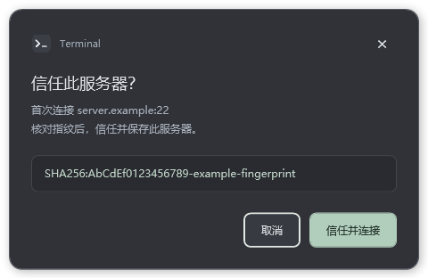

# Terminal

面向 Windows 11 x64 的极简终端，以 Linux SSH 服务器连接为主要场景。深灰界面、JetBrains Mono 字体、自定义标题栏。


## 下载与运行

从 [Releases](https://github.com/tianshizhici-2026/Terminal/releases/latest) 下载最终版 **1.2.3**：

- `Terminal-1.2.3-win-x64.zip`：便携版，包含 .NET 运行时。
- `Terminal-1.2.3-lite-win-x64.zip`：轻量版，需要 [.NET 8 Desktop Runtime x64](https://dotnet.microsoft.com/en-us/download/dotnet/8.0)。

解压整个目录后运行 `Terminal.exe`。两种版本都需要 [Microsoft Edge WebView2 Runtime](https://developer.microsoft.com/en-us/microsoft-edge/webview2/)，Windows 11 通常已安装。应用复用系统 WebView2，不另行打包 Chromium。当前发行版未进行代码签名。

## 功能

- SSH 密码 / 私钥认证；保存、编辑和删除连接配置。
- 密码可选使用 Windows DPAPI 加密保存；取消勾选后保存即可清除。
- 多标签终端、重命名、切换、关闭；支持本地 PowerShell / CMD。
- SFTP 目录浏览、上传、下载、新建目录、重命名及传输进度。
- 跨终端搜索、关键词高亮、大小写匹配。
- 全局字号调整、清晰的 ANSI 配色；内置 JetBrains Mono Regular / Medium。
- 顶栏二级菜单、自定义确认弹窗、贴合任务栏的最大化窗口。
- 首次 SSH 连接核对指纹；已保存指纹变化时阻止连接。



## 快捷键

| 操作 | 快捷键 |
| --- | --- |
| 复制选中文本；无选区时中断 | Ctrl+C |
| 粘贴 | Ctrl+V |
| 打开连接菜单 | Ctrl+T |
| 关闭当前终端 | Ctrl+W |
| 下一个 / 上一个标签 | Ctrl+Tab / Ctrl+Shift+Tab |
| 全局搜索 | Ctrl+K / Ctrl+Shift+F |
| 调整所有终端字号 | Shift+滚轮 |
| 恢复默认字号 | Ctrl+0 |
| 清除搜索高亮 | Esc |
| 重命名标签 | 双击标签 |

字号范围为 10–28 px。每个终端保留 10,000 行回滚历史；搜索最多显示 200 行结果、每个终端最多高亮 1,000 个匹配。输入命令或按 Esc 会清除搜索高亮。JetBrains Mono 不包含中文字形，中文使用系统字体回退。

## 数据与连接

用户配置保存在 `%LOCALAPPDATA%\Terminal`，不在程序目录或本仓库中：

- `settings.json`：字号、连接配置和用户选择保存的密码密文。
- `known-hosts.json`：已确认的 SSH 服务器指纹。
- `WebView`：界面运行缓存。

密码默认不保存；选中“保存密码”后使用 Windows DPAPI 当前用户范围加密。解密依赖 Windows 用户凭据，不能将配置复制到其他用户后直接使用已存密码。删除连接或切换到私钥认证也会清除保存的密码。私钥口令不保存，私钥文件保留在用户指定位置。

会话进程和输出不跨应用重启恢复，连接配置和字号会恢复。上传遇到同名远程文件会拒绝覆盖；下载成功后才将临时文件移动到目标位置。目前不支持代理跳板、多因素交互登录、目录递归传输或内置文件编辑器。

## 构建

需要 Windows 11、.NET 8 SDK、Node.js。

```powershell
npm ci
npm start
```

运行 `scripts/package.ps1` 生成两个发行包及 SHA-256 校验文件，输出位于 `dist/`。`npm run build` 生成界面资源；`npm run publish` 仅生成包含 .NET 的便携目录。

图标源文件位于 `src/Mist.Terminal/Assets/`，可用安装了 Pillow 的 Python 运行 `scripts/build-icon.py` 重新生成。

## 验证

```powershell
npm run test:credentials
npm run test:window
npm run test:dialogs
```

SSH / SFTP 集成测试：安装 Python 包 `paramiko`，运行 `python tests/ssh_fixture.py`，再在另一个终端执行 `npm run test:backend`。测试服务器只监听 `127.0.0.1:22992`，使用测试凭据和临时目录。测试涵盖 ConPTY 读写/缩放/退出、SSH 交互、主机指纹拒绝，以及 128 KiB SFTP 文件的逐字节往返一致性。

桌面界面测试需要专用实例：先构建程序，将 `TERMINAL_DATA_DIR` 环境变量设置为独立测试目录，将 `WEBVIEW2_ADDITIONAL_BROWSER_ARGUMENTS` 设置为 `--remote-debugging-port=9224`，再启动构建目录中的 `Terminal.exe`。

- `node tests/redesign.cjs`：极简布局、二级菜单和面板。
- `npm test`：真实 PowerShell、快捷键、多标签、全局字号和搜索。
- `node tests/credentials-ui.cjs`：密码保存与清除；此脚本使用端口 9225，需相应调整启动环境变量。

界面测试会操作测试实例的会话和剪贴板，请勿对日常使用实例运行。正常发行版默认不启用调试端口。

## 项目结构

- `src/Mist.Terminal/`：WPF / WebView2 宿主、ConPTY、SSH/SFTP、密码存储及窗口管理。
- `ui/`：界面、连接菜单、搜索、快捷键和样式。
- `scripts/`：构建、打包与图标生成。
- `tests/`：原生窗口、密码存储、SSH/SFTP 和界面验证。
- `licenses/`：随发行包提供的第三方许可证。

基于 [Microsoft ConPTY](https://learn.microsoft.com/en-us/windows/console/creating-a-pseudoconsole-session)、[WebView2](https://learn.microsoft.com/en-us/microsoft-edge/webview2/get-started/wpf)、[xterm.js](https://github.com/xtermjs/xterm.js) 和 [SSH.NET](https://github.com/sshnet/SSH.NET)。
